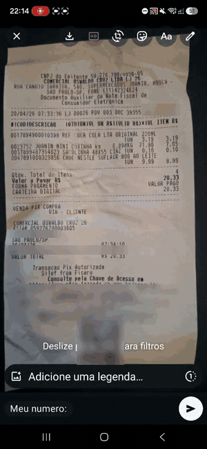
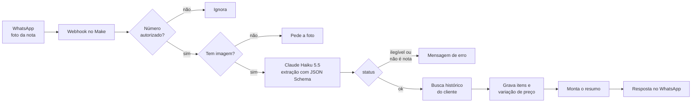
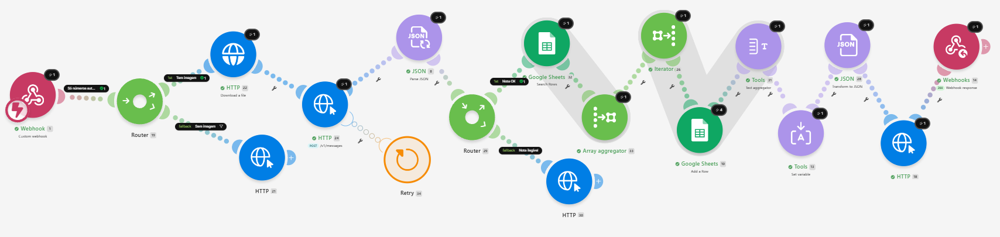

# SmartVitta

Assistente no WhatsApp que lê a foto de uma nota fiscal de supermercado (NFC-e), extrai os itens com o Claude, grava tudo em uma planilha e responde com um resumo da compra: gasto por categoria, variação de preço em relação à última compra e destaques.

Projeto pessoal de estudo, construído com Make (automação), API do Claude (Haiku 5.5) e Google Sheets.



<!-- VÍDEO: arraste o arquivo smartvitta-demo.mp4 para esta linha no editor do GitHub, depois que o repositório estiver público -->

## O que ele faz

O usuário manda uma foto do cupom fiscal pelo WhatsApp e recebe, em cerca de 20 segundos:

- a lista de itens com o valor de cada um;
- a variação do preço unitário de cada produto em relação à última compra daquele mesmo cliente (▲ alta, ▼ queda, = mesmo preço);
- o gasto somado por categoria (Hortifruti, Proteína, Bebida, Doces e Snacks etc.);
- dois ou três destaques escritos pelo modelo, cada um com um fato concreto da nota.

Os três caminhos do fluxo aparecem no vídeo de demonstração:

| Entrada | Resposta |
|---|---|
| Foto de uma nota legível | Grava os itens na planilha e envia o resumo |
| Foto que não é uma nota | Avisa que não conseguiu ler e não grava nada |
| Mensagem de texto, sem foto | Pede a foto da nota |

**Sobre os dados da demonstração.** A variação de preço é calculada pelo cenário, comparando cada item com o histórico do cliente na planilha. Como ainda não existe um histórico real de compras em datas diferentes, os preços do histórico foram editados à mão para que as altas e quedas aparecessem no vídeo. Os valores da nota lida são os reais.

## Como funciona



Cenário no Make, com uma execução completa:



## Decisões de projeto

**O modelo só faz o que exige julgamento.** O Claude lê a imagem, classifica cada item em uma categoria e escreve os destaques. Somas por categoria, variação de preço e formatação da mensagem são calculadas no Make, com fórmulas. Conta feita por fórmula não erra aritmética e não custa tokens.

**Saída estruturada.** A chamada à API usa `output_config` com JSON Schema ([schema](prompts/schema_nfce.json)). A resposta chega no formato esperado, com `status` e `categoria` restritos a uma lista fechada, o que eliminou os erros de parse das primeiras versões.

**O prompt pede autoconferência.** O [prompt](prompts/prompt_nfce.txt) pede duas checagens antes de responder: quantidade × valor unitário deve bater com o valor total de cada item, e a soma dos itens deve bater com o total da nota.

**Código do produto como chave.** A comparação de preço usa o código impresso na nota, não o nome do item, porque o nome varia entre leituras. O prompt trata o caso em que o número sequencial da linha vem colado ao código.

**Histórico isolado por cliente.** A busca na planilha filtra pelo número de quem enviou a nota. A variação de preço de um cliente não enxerga as compras de outro.

**Falhas da API.** A chamada ao Claude tem nova tentativa automática configurada (3 tentativas, intervalo de 1 minuto).

**Acesso restrito.** O cenário só responde a uma lista de números autorizados. A regra nasceu de um erro real, descrito abaixo.

## O que aprendi

- Com o cenário ligado, o webhook recebe tudo o que chega na conta de WhatsApp conectada, inclusive mensagens de grupos. Em um teste, o assistente respondeu no privado a pessoas de um grupo. A lista de números autorizados veio daí.
- O código impresso na nota nem sempre é um código de barras. Códigos internos da loja só servem para comparar preços dentro do mesmo estabelecimento.
- Em Tabelas do Google Sheets, o formato das linhas novas vem do tipo da coluna, não da formatação das células.

## Limitações conhecidas

- Ainda não há avaliação quantitativa da extração. Os testes foram feitos com poucas notas, conferidas a olho.
- A mesma nota pode gerar nomes de item, duração estimada e, às vezes, categorias diferentes entre execuções.
- A comparação de preço usa só o código do produto. Para códigos internos de loja, falta incluir o estabelecimento na busca.
- Notas com desconto ou acréscimo: a soma das categorias não fecha com o total pago.
- A busca de histórico lê no máximo 1.000 linhas por cliente.
- A nova tentativa automática da API não foi testada com um erro real. Se as tentativas se esgotarem, o usuário não é avisado.
- O envio pelo WhatsApp usou a Z-API em período de teste, já encerrado. Por isso a demonstração é gravada e o cenário não fica ligado.

## Próximos passos

- Avaliação com 15 a 20 notas de estabelecimentos e layouts diferentes, com gabarito conferido à mão: taxa de acerto por campo e consistência entre execuções repetidas.
- Histórico real de compras, em banco de dados, no lugar da planilha.
- Painel no Looker Studio com gasto por categoria e evolução de preço por produto.
- Responder perguntas em linguagem natural sobre o histórico de compras.

## Estrutura do repositório

```
make/smartvitta-blueprint.json   cenário do Make, sem chaves
prompts/prompt_nfce.txt          prompt de extração
prompts/schema_nfce.json         JSON Schema da resposta
docs/                            GIF da demonstração e print do cenário
```

## Como reproduzir

O blueprint publicado é uma cópia do cenário com chaves e identificadores substituídos por valores de exemplo. A importação dessa cópia ainda não foi testada.

1. No Make, crie um cenário e importe `make/smartvitta-blueprint.json` (menu **Import Blueprint**).
2. Substitua os valores de exemplo: `SUA_CHAVE_ANTHROPIC`, `SUA_SECRET_KEY_ZAPI`, `SEU_CHANNEL_ID`, `ID_DA_SUA_PLANILHA` e o número autorizado no primeiro filtro.
3. Reconecte o webhook, a conta Google e a estrutura de dados do módulo de parse.
4. Crie a planilha com as colunas: ID CLIENTE, DATA/HORA, ESTABELECIMENTO, PRODUTO, CATEGORIA, QTD, VALOR UNITARIO, VALOR TOTAL, DURACAO ESTIMADA, INSIGHT, VARIACAO DE PRECO, CÓDIGO.

## Autor

Fabrício Sparapan Clarena, estudante de Engenharia de Informação na UFABC. [LinkedIn](https://www.linkedin.com/in/fabrício-sparapan-clarena-b5b740350)
